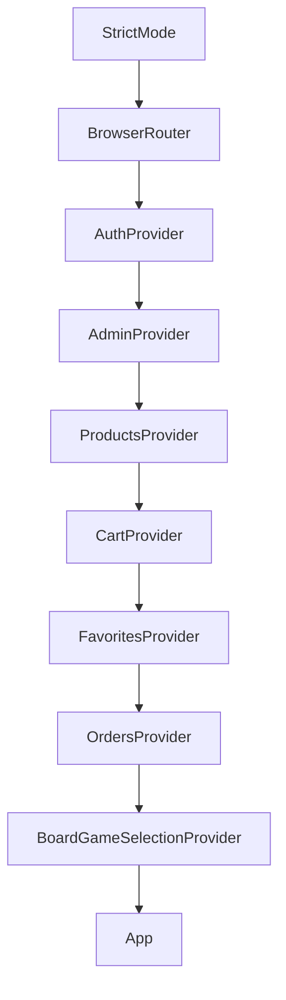
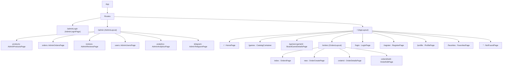

# Архітектура компонентів та клієнтського застосунку

Цей документ описує повну архітектуру фронтенду вебзастосунку **«Dice & Deck»**: компонентну ієрархію, контексти керування станом (React Context API), власні хуки (custom hooks), контракти властивостей (props), маршрутизацію (React Router v7) та взаємодію з REST API.

---

## 1. Загальний огляд фронтенд-стеку

- **Бібліотека інтерфейсу:** React 19 (Strict Mode, Hooks, Functional Components)
- **Збирач та середовище:** Vite 6
- **Маршрутизація:** React Router v7 (`react-router`)
- **Керування глобальним станом:** Multi-Provider Context API (7 провайдерів)
- **Персистентність даних:** `localStorage` (кошик, сесійний Bearer-токен, fallback-дані) + синхронізація через REST API
- **Стилізація:** Модульний чистий CSS (Custom Properties, BEM-подібна методологія, темна/світла тема та палітра акцентів, адаптивний лейаут через Flexbox/Grid)

---

## 2. Ієрархія провайдерів (Providers Hierarchy)

Точкою входу клієнтського застосунку є `src/main.jsx`. Всі провайдери вкладені у суворо визначеному порядку відповідно до залежностей між ними:



### Призначення та зона відповідальності кожного провайдера:

| Провайдер | Файл | Відповідальність та стан |
| :--- | :--- | :--- |
| **`AuthProvider`** | `src/providers/AuthProvider.jsx` | Сесія поточного користувача (`user`), токен авторизації (`authToken`), методи `login`, `register`, `logout`, `updateProfile`. Прапорець `isAdmin` / `isManager`. |
| **`AdminProvider`** | `src/providers/AdminProvider.jsx` | Керування панеллю адміністратора: статистика (`analytics`), керування користувачами (`users`), налаштування інтеграції Telegram (`telegramSettings`). |
| **`ProductsProvider`** | `src/providers/ProductsProvider.jsx` | Каталог товарів (`products`), стан завантаження (`loading`), фільтри категорій, методи додавання/редагування/видалення товарів (CRUD). |
| **`CartProvider`** | `src/providers/CartProvider.jsx` | Кошик покупок (`cartItems`), відкриття/закриття дровера (`isCartOpen`), методи `addToCart`, `removeFromCart`, `updateQuantity`, `clearCart`. Автоматичне збереження в `localStorage`. |
| **`FavoritesProvider`** | `src/providers/FavoritesProvider.jsx` | Список улюблених ігор (`favorites`), перемикач `toggleFavorite`, перевірка `isFavorite(id)`. Синхронізується з БД для авторизованих користувачів. |
| **`OrdersProvider`** | `src/providers/OrdersProvider.jsx` | Замовлення користувача та магазину (`orders`), оформлення нового замовлення (`createOrder`), редагування, оновлення статусу, видалення, фільтрація. |
| **`BoardGameSelectionProvider`** | `src/providers/BoardGameSelectionProvider.jsx` | Збереження обраної для швидкого замовлення або бронювання гри (`selectedId`, `selectedGame`), швидкий перехід у форму замовлення. |

---

## 3. Дерево сторінок та компонентів

Маршрутизація організована у `src/App.jsx` з використанням layout-роутів:

### 3.1. Структура маршрутів



---

## 4. Каталог компонентів інтерфейсу

### 4.1. Макетні компоненти (`src/components/layout/`)

- **`AppLayout`**: Основна оболонка публічної частини сайту. Включає доступне посилання для скрінрідерів (`#main-content`), `SiteHeader`, контейнер `<main>` з `<Outlet />`, `CartDrawer` та семантичний `<footer>`.
- **`SiteHeader`**: Шапка сайту. Містить логотип магазину, головну навігацію (`MainNav`), лічильник кошика з кнопкою відкриття, індикатор улюблених товарів, статус авторизації (аватар, ім'я, перехід у профіль / вихід або кнопки «Вхід / Реєстрація»), а для адміністраторів — кнопку швидкого переходу в адмін-панель.
- **`OrdersLayout`**: Внутрішня оболонка для розділу замовлень із хлібними крихтами та швидким перемиканням списку замовлень і створення нового.
- **`AdminLayout`**: Оболонка панелі керування адміністратора. Включає сайдбар з навігацією за розділами (Товари, Замовлення, Відгуки, Користувачі, Аналітика, Telegram), верхній бар з інформацією про адміністратора та кнопку повернення на вітрину магазину.

### 4.2. Компоненти каталогу та ігор (`src/components/games/`)

- **`BoardGameList`**: Відображає сітку карток або `EmptyState`, якщо за поточними фільтрами нічого не знайдено.
- **`BoardGameCard`**: Інтерактивна картка гри. Містить зображення, бейдж наявності (`AvailabilityBadge`), категорію, кількість гравців, час партії, рейтинг, ціну, кнопку швидкого замовлення, кнопку додавання в кошик та кнопку «сердечко» (в обране).
- **`BoardGameFilters`**: Панель фільтрації каталогу за текстовим запитом, категорією (стратегії, паті-ігри, сімейні тощо), діапазоном цін, наявністю та сортуванням.
- **`CatalogSummary`**: Інформаційний блок із лічильником знайдених товарів та активних критеріїв фільтрації.
- **`AvailabilityBadge`**: Єдиний компонент виведення статусу складу: «В наявності» (`in-stock`), «Очікується поставка» (`out-of-stock`), «Закінчується» (`low-stock`).

### 4.3. Компоненти кошика (`src/components/cart/`)

- **`CartDrawer`**: Висувна бічна панель (Slide-over drawer). Дозволяє:
  - переглядати обрані товари з прев'ю, назвою та ціною;
  - змінювати кількість кожної позиції (`+` / `-`);
  - видаляти товар з кошика;
  - бачити загальну суму замовлення;
  - швидко перейти до оформлення замовлення (`/orders/new`).

### 4.4. Компоненти замовлень (`src/components/orders/`)

- **`OrderForm`**: Повнофункціональна форма оформлення замовлення. Реалізує валідацію клієнтських полів, маску введення телефону, вибір служби доставки («Нова Пошта», «Укрпошта»), вибір міста, відділення, способу оплати, введення Telegram Chat ID для отримання статусу.
- **`OrderTable`**: Таблиця зі списком замовлень, сортуванням за датою/сумою та фільтрами за статусом (`pending`, `processing`, `completed`, `cancelled`).
- **`OrderRow`**: Окремий рядок таблиці замовлень з бейджем статусу, списком товарів та кнопками дій (перегляд, зміна статусу, редагування, видалення).
- **`OrderSummary`**: Картка підсумку замовлення із сумою, переліком замовлених ігор та інформацією про доставку.
- **`OrderFilters`**: Елементи фільтрації списку замовлень (пошук за ПІБ/номером, фільтр статусу).
- **`OrderNotice`**: Інформаційні сповіщення про стан замовлення (успішне створення, оновлення статусу, попередження).

### 4.5. Базові UI компоненти (`src/components/ui/`)

- **`AppButton`**: Універсальна кнопка з підтримкою варіантів `primary`, `secondary`, `accent`, `danger`, `outline`, розмірів `sm`, `md`, `lg` та стану завантаження (`loading`).
- **`FormField`**: Обгортка для полів вводу з доступним пов'язуванням `label`, підказки (`hint`) та виведенням тексту помилки (`error`).
- **`PageHeading`**: Стандартизований заголовок сторінки з описом та слотом для додаткових дій/кнопок.
- **`EmptyState`**: Порожній стан із зображенням/іконкою, текстом та кнопкою заклику до дії (CTA).
- **`Section`**: Семантичний блок `<section>` з `aria-labelledby`.
- **`Icons`**: Набір масштабованих SVG-іконок інтерфейсу (кошик, зірка, сердечко, користувач, лупа, шестерня, вантажівка тощо).

---

## 5. Власні хуки (Custom Hooks)

Всі повторювані бізнес-операції винесені в користувацькі хуки:

```
src/hooks/
├── useAuth.js                 # Доступ до AuthContext (user, login, logout, register, isAdmin)
├── useCart.js                 # Доступ до CartContext (cartItems, total, addToCart, remove, clear)
├── useFavorites.js            # Доступ до FavoritesContext (favorites, toggleFavorite, isFavorite)
├── useProducts.js             # Доступ до ProductsContext (products, loading, addProduct, update, delete)
├── useOrders.js               # Доступ до OrdersContext (orders, createOrder, updateStatus, deleteOrder)
├── useAdmin.js                # Доступ до AdminContext (analytics, users, telegram, moderation)
├── useBoardGameSelection.js   # Доступ до вибору поточної гри
├── useBoardGameFilters.js     # Керування станом та логікою фільтрації каталогу
├── useOrderFilters.js         # Керування фільтрами замовлень
└── useDeleteOrder.js          # Логіка підтвердження та безпечного видалення замовлення
```

### Контракт хука `useCart` (приклад):
```javascript
const {
  cartItems,      // Array<{ id, gameId, title, price, image, quantity }>
  isCartOpen,     // boolean
  totalPrice,     // number (сума всіх товарів)
  totalCount,     // number (сукупна кількість одиниць)
  addToCart,      // (game, quantity = 1) => void
  removeFromCart, // (gameId) => void
  updateQuantity, // (gameId, newQty) => void
  clearCart,      // () => void
  toggleCart,     // () => void
  openCart,       // () => void
  closeCart       // () => void
} = useCart();
```

---

## 6. Валідація форм та шар доменної логіки

Клієнтська валідація замовлення відокремлена у `src/domain/orderValidation.js` відповідно до принципів Clean Architecture:
- Функція `validateOrder(input, items)` перевіряє:
  1. `gameId` або `orderedItems` — наявність товарів у замовленні;
  2. `fullName` — мінімум 2 символи;
  3. `phone` — валідний формат українського/міжнародного номера (`/^\+?[\d\s\-()]{10,}$/`);
  4. `deliveryService` — обов'язковий вибір (`nova_poshta` | `ukr_poshta`);
  5. `city` — обов'язкова назва міста;
  6. `branch` — обов'язковий номер або адреса відділення;
  7. `paymentMethod` — обов'язковий вибір (`cash_on_delivery` | `online`);
  8. `durationHours` — коректне ціле число від 1 до 8 (для оренди/бронювання);
  9. `telegramChatId` — необов'язковий, перевіряється на числовий формат.

Повертає об'єкт помилок `{ [fieldName]: 'Повідомлення про помилку' }`. Якщо об'єкт порожній — валідація пройдена успішно.

---

## 7. Архітектура стилів (CSS System)

Стилі проєкту розбиті за модульним принципом у директорії `src/styles/`:
- `variables.css` — колірна палітра, шрифти, радіуси заокруглення, тіні, відступи, breakpoints для responsive верстки.
- `base.css` — скидання стилів (reset/normalize), типографіка, базові селектори HTML.
- `layout.css` — сітки контейнерів, шапка сайту, підвал, сайдбари.
- `cards.css` — стилізація карток ігор, ефекти при наведенні (hover), анімація.
- `buttons.css` — кнопки дій, модифікатори розмірів і кольорів.
- `forms.css` — поля вводу, підписи, випадаючі списки, валідаційні повідомлення.
- `cart.css` — анімований дровер кошика, елементи списку товарів кошика.
- `orders.css` — таблиці замовлень, бейджі статусів, підсумкові картки.
- `product-details.css` — сторінка гри: галерея фото, блок характеристик, секція відгуків і форма додавання рецензії.
- `catalog.css` — сітка каталогу та панель розширених фільтрів.
- `auth.css` — форми входу, реєстрації та сторінка особистого профілю.
- `admin.css` (в корені `src/`) — спеціалізовані таблиці, графіки аналітики, картки метрик панелі адміністратора.
