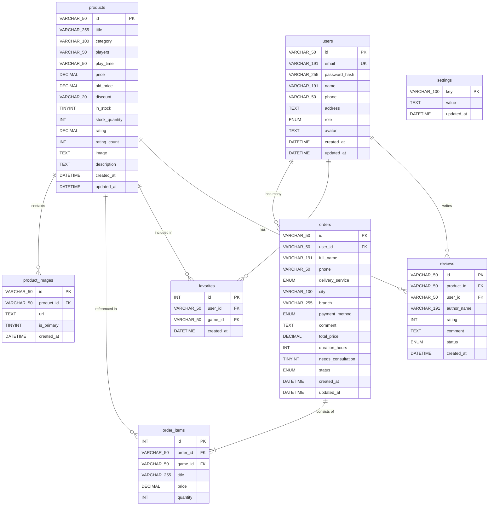

# Схема та архітектура бази даних MySQL

Цей документ детально описує структуру реляційної бази даних вебзастосунку **«Dice & Deck»**, специфікацію таблиць, типи даних, індекси, зовнішні ключі (Foreign Keys) та правила забезпечення цілісності.

---

## 1. Загальні параметри СУБД

- **СУБД:** MySQL 8.0+ / MariaDB 10.4+
- **Ім'я бази даних:** `tabletop_shop`
- **Двигун сховища:** `InnoDB` (забезпечує підтримку ACID-транзакцій та зовнішніх ключів)
- **Кодування:** `utf8mb4`
- **Зіставлення (Collation):** `utf8mb4_unicode_ci` (повна підтримка української мови, емодзі та символів різного регістру)

---

## 2. Діаграма сутностей та зв'язків (ERD)

---

## 3. Детальний опис таблиць

### 3.1. Таблиця `users` (Користувачі)
Зберігає облікові записи відвідувачів, менеджерів та адміністраторів.

| Поле | Тип | Nullable | За замовчуванням | Опис |
| :--- | :--- | :--- | :--- | :--- |
| `id` | `VARCHAR(50)` | NO | — | Первинний ключ (`usr-...`) |
| `email` | `VARCHAR(191)` | NO | — | Унікальний email користувача (індексований) |
| `password_hash` | `VARCHAR(255)` | NO | — | Хеш пароля (алгоритм `PASSWORD_BCRYPT`) |
| `name` | `VARCHAR(191)` | NO | — | Повне ім'я та прізвище |
| `phone` | `VARCHAR(50)` | YES | NULL | Номер мобільного телефону |
| `address` | `TEXT` | YES | NULL | Збережена адреса або відділення доставки |
| `role` | `ENUM('user', 'manager', 'admin')` | NO | `'user'` | Рівень прав у системі |
| `avatar` | `TEXT` | YES | NULL | URL-посилання або шлях до фотографії |
| `created_at` | `DATETIME` | NO | `CURRENT_TIMESTAMP` | Дата реєстрації |
| `updated_at` | `DATETIME` | NO | `CURRENT_TIMESTAMP` | Дата останнього оновлення профілю |

- **Індекси:**
  - `PRIMARY KEY (id)`
  - `UNIQUE KEY idx_email (email)`
  - `INDEX idx_role (role)`

---

### 3.2. Таблиця `products` (Каталог настільних ігор)
Основна сутність асортименту магазину.

| Поле | Тип | Nullable | За замовчуванням | Опис |
| :--- | :--- | :--- | :--- | :--- |
| `id` | `VARCHAR(50)` | NO | — | Первинний ключ (`game-001`, `game-002`) |
| `title` | `VARCHAR(255)` | NO | — | Офіційна назва гри |
| `category` | `VARCHAR(100)` | NO | — | Категорія/жанр (Стратегія, Паті-гра тощо) |
| `players` | `VARCHAR(50)` | NO | — | Діапазон гравців (наприклад, `"2-4"`) |
| `play_time` | `VARCHAR(50)` | NO | — | Тривалість гри (наприклад, `"45-60 хв"`) |
| `price` | `DECIMAL(10,2)` | NO | — | Актуальна роздрібна вартість (UAH) |
| `old_price` | `DECIMAL(10,2)` | YES | NULL | Початкова вартість (для товарів зі знижкою) |
| `discount` | `VARCHAR(20)` | YES | NULL | Текстовий бейдж знижки (`"-15%"`) |
| `in_stock` | `TINYINT(1)` | NO | `1` | Прапорець наявності (1 - є, 0 - немає) |
| `stock_quantity` | `INT` | NO | `0` | Кількість одиниць товару на складі |
| `rating` | `DECIMAL(2,1)` | NO | `5.0` | Середній розрахунковий бал (1.0 – 5.0) |
| `rating_count` | `INT` | NO | `0` | Загальна кількість схвалених відгуків |
| `image` | `TEXT` | NO | — | Шлях до головного зображення обкладинки |
| `description` | `TEXT` | YES | NULL | Розширений опис, сюжет та комплектація |
| `created_at` | `DATETIME` | NO | `CURRENT_TIMESTAMP` | Дата створення картки |
| `updated_at` | `DATETIME` | NO | `CURRENT_TIMESTAMP` | Дата модифікації |

- **Індекси:**
  - `PRIMARY KEY (id)`
  - `INDEX idx_category (category)`
  - `INDEX idx_in_stock (in_stock)`
  - `INDEX idx_stock_quantity (stock_quantity)`
  - `INDEX idx_price (price)`
  - `FULLTEXT INDEX idx_fulltext_search (title, category, description)`

---

### 3.3. Таблиця `product_images` (Додаткові фотографії товарів)

| Поле | Тип | Nullable | Опис |
| :--- | :--- | :--- | :--- |
| `id` | `VARCHAR(50)` | NO | Первинний ключ |
| `product_id` | `VARCHAR(50)` | NO | Зовнішній ключ до `products(id)` з `ON DELETE CASCADE` |
| `url` | `TEXT` | NO | Шлях або URL зображення |
| `is_primary` | `TINYINT(1)` | NO | 1, якщо головне фото; 0 — додаткове |
| `created_at` | `DATETIME` | NO | Дата завантаження |

---

### 3.4. Таблиця `orders` (Замовлення)

| Поле | Тип | Nullable | За замовчуванням | Опис |
| :--- | :--- | :--- | :--- | :--- |
| `id` | `VARCHAR(50)` | NO | — | Первинний ключ (`ord-...`) |
| `user_id` | `VARCHAR(50)` | YES | NULL | Зовнішній ключ до `users(id)` (`ON DELETE SET NULL`) |
| `game_id` | `VARCHAR(50)` | YES | NULL | Посилання на основну гру (для сумісності) |
| `full_name` | `VARCHAR(191)` | NO | — | ПІБ одержувача |
| `phone` | `VARCHAR(50)` | NO | — | Контактний телефон |
| `delivery_service` | `ENUM('nova_poshta', 'ukr_poshta')` | NO | — | Оператор поштової доставки |
| `city` | `VARCHAR(100)` | NO | — | Населений пункт |
| `branch` | `VARCHAR(255)` | NO | — | Номер відділення/поштомату |
| `payment_method` | `ENUM('cash_on_delivery', 'online')` | NO | — | Метод розрахунку |
| `comment` | `TEXT` | YES | NULL | Примітки та побажання замовника |
| `total_price` | `DECIMAL(10,2)` | NO | — | Підсумкова сума замовлення |
| `duration_hours` | `INT` | NO | `1` | Тривалість сесії/оренди гри |
| `needs_consultation` | `TINYINT(1)` | NO | `0` | Чи потрібен дзвінок майстра/консультанта |
| `status` | `ENUM('pending', 'processing', 'completed', 'cancelled')` | NO | `'pending'` | Стан виконання замовлення |
| `created_at` | `DATETIME` | NO | `CURRENT_TIMESTAMP` | Час оформлення |
| `updated_at` | `DATETIME` | NO | `CURRENT_TIMESTAMP` | Час зміни статусу |

- **Індекси:**
  - `PRIMARY KEY (id)`
  - `INDEX idx_user_id (user_id)`
  - `INDEX idx_status (status)`
  - `INDEX idx_created_at (created_at)`

---

### 3.5. Таблиця `order_items` (Товарні позиції замовлення)

| Поле | Тип | Nullable | Опис |
| :--- | :--- | :--- | :--- |
| `id` | `INT AUTO_INCREMENT` | NO | Первинний ключ |
| `order_id` | `VARCHAR(50)` | NO | Зовнішній ключ до `orders(id)` (`ON DELETE CASCADE`) |
| `game_id` | `VARCHAR(50)` | YES | Зовнішній ключ до `products(id)` |
| `title` | `VARCHAR(255)` | NO | Фіксована назва гри |
| `price` | `DECIMAL(10,2)` | NO | Фіксована ціна за одиницю на момент купівлі |
| `quantity` | `INT` | NO | Кількість замовлених коробок |

---

### 3.6. Таблиця `favorites` (Список обраного)

| Поле | Тип | Nullable | Опис |
| :--- | :--- | :--- | :--- |
| `id` | `INT AUTO_INCREMENT` | NO | Первинний ключ |
| `user_id` | `VARCHAR(50)` | NO | Зовнішній ключ до `users(id)` (`ON DELETE CASCADE`) |
| `game_id` | `VARCHAR(50)` | NO | Зовнішній ключ до `products(id)` (`ON DELETE CASCADE`) |
| `created_at` | `DATETIME` | NO | Дата додавання до улюбленого |

- **Унікальний індекс:** `UNIQUE KEY unique_user_game (user_id, game_id)`

---

### 3.7. Таблиця `reviews` (Відгуки та рейтинг)

| Поле | Тип | Nullable | За замовчуванням | Опис |
| :--- | :--- | :--- | :--- | :--- |
| `id` | `VARCHAR(50)` | NO | — | Первинний ключ (`rev-...`) |
| `product_id` | `VARCHAR(50)` | NO | — | Зовнішній ключ до `products(id)` (`ON DELETE CASCADE`) |
| `user_id` | `VARCHAR(50)` | YES | NULL | Автор (зовнішній ключ до `users(id)`, `ON DELETE SET NULL`) |
| `author_name` | `VARCHAR(191)` | NO | — | Відображуване ім'я автора відгуку |
| `rating` | `INT` | NO | `5` | Оцінка від 1 до 5 |
| `comment` | `TEXT` | YES | NULL | Текст відгуку |
| `status` | `ENUM('pending', 'approved', 'rejected')` | NO | `'pending'` | Статус премодерації адміністратором |
| `created_at` | `DATETIME` | NO | `CURRENT_TIMESTAMP` | Час створення відгуку |

- **Автоматичний перерахунок рейтингу:**
  При схваленні або зміні статусу відгуку в `Review::updateStatus()` та `Review::delete()` викликається метод `recalculateProductRating($productId)`. Він обчислює середній бал `AVG(rating)` та оновлює поля `rating` і `rating_count` у таблиці `products`.

---

### 3.8. Таблиця `settings` (Системні параметри та Telegram)

| Поле | Тип | Nullable | Опис |
| :--- | :--- | :--- | :--- |
| `key` | `VARCHAR(100)` | NO | Первинний ключ (назва параметра) |
| `value` | `TEXT` | YES | Збережене значення |
| `updated_at` | `DATETIME` | NO | Час останньої зміни |

**Ключові параметри:**
- `telegram_bot_token` — токен доступу до Bot API від `@BotFather`;
- `telegram_admin_chat_id` — числовий ID чату адміністратора або групи;
- `telegram_bot_username` — публічне ім'я бота в Telegram;
- `telegram_notifications_enabled` — логічний прапорець активації відправки (`1` або `0`).

---

## 4. Стратегія цілісності даних

1. **Каскадне видалення (CASCADE):**
   - Видалення гри з `products` автоматично видаляє її фотографії (`product_images`), зв'язки в обраному (`favorites`) та відгуки (`reviews`).
   - Видалення замовлення з `orders` автоматично видаляє пов'язані з ним позиції з `order_items`.
2. **Збереження історії (SET NULL):**
   - Якщо користувач видаляє свій обліковий запис із `users`, його історичні замовлення в `orders` та написані відгуки у `reviews` не зникають, а поле `user_id` встановлюється у `NULL`, зберігаючи статистику та виручку магазину.
3. **Захист від дублювання:**
   - Таблиця `favorites` містить складений унікальний ключ `(user_id, game_id)`, що унеможливлює повторне додавання тієї самої гри одним і тим самим користувачем.
   - Поле `email` у таблиці `users` позначено як `UNIQUE`.

