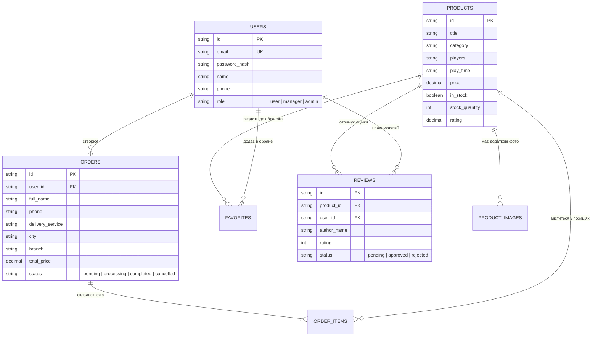

# Специфікація та план розробки вебзастосунку «Dice & Deck»
## Комплексний навчальний проєкт курсової роботи: Інтернет-магазин та клуб настільних ігор

---

## 1. Вступ та аналіз предметної області

### 1.1. Тема проєкту
Повнофункціональний інтернет-магазин, сервіс бронювання та клуб настільних ігор **«Dice & Deck»** із клієнтським Single Page Application (SPA) на базі **React 19** та серверною частиною **RESTful API на PHP 8.1+ з MySQL** і модулем сповіщень через **Telegram Bot API**.

### 1.2. Проблема предметної області
Настільні ігри є товаром зі специфічними характеристиками, де вибір покупця залежить від комбінації багатьох критеріїв:
- точної кількості учасників (соло-ігри, дуельні на 2 гравців, вечірні паті-гейми на 6–12 осіб);
- вікового порогу (дитячі, сімейні, підліткові або 18+);
- середньої тривалості партії (короткі філери на 15–20 хв або масштабні хардкорні стратегії на 3–5 годин);
- жанру та механік (євро-стратегії, колодобудівні, кооперативні, детективні, блеф);
- рівня складності та комплексності правил (за шкалою від 1 до 5).

Традиційні інтернет-магазини часто не мають необхідної фільтрації, чесних відгуків із модерацією, наочного статусу наявності на складі та оперативного зв'язку щодо статусу комплектації замовлення через сучасні месенджери.

### 1.3. Мета розробки
Спроєктувати та реалізувати масштабований, швидкий та зручний вебзастосунок, який охоплює весь цикл взаємодії з клієнтом: від інтерактивного каталогу з миттєвою фільтрацією до повноцінного кошика, оформлення замовлення, особистого кабінету та захищеної панелі адміністратора з аналітикою та автоматичними сповіщеннями в Telegram.

---

## 2. Модель даних та ключові сутності

Система базується на взаємодії 8 реляційних сутностей:

### Специфікація сутностей:
1. **`Product` (Настільна гра):** комерційна назва, категорія/жанр, параметри гравців та часу партії, роздрібна ціна, стара акційна ціна, мітка знижки, стан наявності (`in_stock`), фізичний залишок коробок (`stock_quantity`), автоматично розраховуваний рейтинг (1.0–5.0), кількість рецензій, обкладинка та розширений опис.
2. **`User` (Користувач):** обліковий запис покупця або адміністратора, хешований пароль (BCRYPT), роль (`user`, `manager`, `admin`), адреса доставки за замовчуванням, аватар.
3. **`Order` (Замовлення):** номер замовлення, одержувач, телефон, поштовий оператор («Нова Пошта», «Укрпошта»), місто, відділення, метод оплати, примітки, сумарна вартість, Telegram Chat ID та статус обробки (`pending`, `processing`, `completed`, `cancelled`).
4. **`OrderItem` (Позиція замовлення):** зв'язок замовлення з грою, зафіксована назва, фіксована ціна на момент купівлі та кількість одиниць.
5. **`Review` (Відгук):** рецензія покупця з балом (1–5), коментарем та статусом премодерації (`pending`, `approved`, `rejected`).
6. **`Favorite` (Обране):** збережені користувачем ігри для швидкого доступу.
7. **`ProductImage` (Медіа):** додаткові фотографії компонентів гри.
8. **`Settings` (Конфігурація):** системні налаштування Telegram Bot API (`token`, `chat_id`, `username`, `enabled`).

---

## 3. Детальний план та специфікація всіх сторінок застосунку

У вебзастосунку реалізовано 16 окремих маршрутів і сторінок, згрупованих за трьома зонами доступу:
- **Публічна вітрина магазину (Public Storefront)**
- **Клієнтський кабінет (Customer Account)**
- **Панель керування та адміністрування (Admin Panel)**

```mermaid
graph TD
    App[Вебзастосунок Dice & Deck] --> Public[Публічна вітрина]
    App --> Account[Клієнтський розділ]
    App --> Admin[Адміністративна панель]

    Public --> P1["/ (Головна сторінка)"]
    Public --> P2["/games (Каталог ігор)"]
    Public --> P3["/games/:gameId (Деталі гри та відгуки)"]
    Public --> P4["/orders/new (Оформлення замовлення)"]
    Public --> P5["/orders/:orderId (Деталі замовлення)"]
    Public --> P6["* (404 Not Found)"]

    Account --> A1["/login (Авторизація)"]
    Account --> A2["/register (Реєстрація)"]
    Account --> A3["/profile (Профіль та історія)"]
    Account --> A4["/favorites (Список обраного)"]
    Account --> A5["/orders (Мої замовлення)"]
    Account --> A6["/orders/:orderId/edit (Редагування заявки)"]

    Admin --> AD0["/adminLogin (Вхід в адмінку)"]
    Admin --> AD1["/admin/products (Керування товарами)"]
    Admin --> AD2["/admin/orders (Керування замовленнями)"]
    Admin --> AD3["/admin/reviews (Модерація відгуків)"]
    Admin --> AD4["/admin/users (Керування користувачами)"]
    Admin --> AD5["/admin/analytics (Звіти та KPI)"]
    Admin --> AD6["/admin/telegram (Налаштування бота)"]
```

---

### 3.1. Публічна вітрина магазину

#### 1. Головна сторінка (`HomePage.jsx`, маршрут `/`)
- **Призначення:** Візитна картка магазину та клубу, знайомство користувача з асортиментом та спеціальними пропозиціями.
- **Ключові блоки та компоненти:**
  - `SiteHeader`: навігація, кнопка відкриття кошика, лічильник обраного, статус користувача.
  - **Hero-блок:** яскравий заголовок, фонове зображення та кнопки швидкого переходу («Перейти до каталогу», «Забронювати гру»).
  - **Секція «Про клуб Dice & Deck»:** переваги магазину (ігротека, консультації гейммайстрів, швидка доставка по Україні).
  - **Секція «Популярні настільні ігри»:** підбірка топових товарів з бейджами наявності, цінами та кнопками покупки.
  - `CartDrawer`: бічна висувна панель кошика.
  - `SiteFooter`: контактна інформація, графік роботи, соціальні мережі, копірайт.
- **Стан та джерела даних:** Дані товарів з `ProductsContext`, стан кошика з `CartContext`.

#### 2. Каталог настільних ігор (`CatalogContainer.jsx` / `BoardGameListPage.jsx`, маршрут `/games`)
- **Призначення:** Повний структурований каталог продукції з багаторівневою фільтрацією та сортуванням.
- **Ключові блоки та компоненти:**
  - `BoardGameFilters`:
    - поле текстового пошуку `query` (назва, жанр, опис);
    - вибір категорії (Стратегії, Паті-ігри, Кооперативні, Сімейні, Детективи тощо);
    - фільтрація за діапазоном цін (`minPrice` / `maxPrice`);
    - перемикач «Тільки в наявності» (`availableOnly`);
    - сортування за критеріями (за рейтингом, за спаданням/зростанням ціни, за назвою);
    - кнопка скидання всіх фільтрів.
  - `CatalogSummary`: лічильник знайдених товарів, активні бейджі фільтрів.
  - `BoardGameList`: адаптивна CSS-сітка товарних карток.
  - `BoardGameCard`: зображення коробки, назва, категорія, гравці, тривалість, ціна, знижка, статус наявності, кнопка «В кошик», кнопка обраного («сердечко») та кнопка швидкого замовлення.
  - `EmptyState`: інформаційне повідомлення, якщо за поточними фільтрами нічого не знайдено, із кнопкою скидання.
- **Синхронізація стану:** Параметри фільтрації зберігаються в URL query parameters (`?q=...&category=...&available=1`), що дозволяє ділитися посиланням на конкретну вибірку.

#### 3. Детальна сторінка настільної гри (`BoardGameDetailsPage.jsx`, маршрут `/games/:gameId`)
- **Призначення:** Максимально повна презентація окремого товару перед покупкою, перегляд характеристик та оцінок реальних гравців.
- **Ключові блоки та компоненти:**
  - **Хлібні крихти (Breadcrumbs):** навігаційний шлях «Головна → Каталог → [Назва гри]».
  - **Галерея зображень:** основне фото високої роздільної здатності та мініатюри додаткових фотографій компонентів.
  - **Блок характеристик:**
    - кількість гравців (наприклад, 2–4);
    - тривалість партії (наприклад, 45–90 хв);
    - віковий ценз (наприклад, 10+);
    - складність правил (шкала зірок або оцінка від 1 до 5);
    - статус на складі (`AvailabilityBadge`: «В наявності», «Закінчується», «Очікується поставка»).
  - **Блок покупки:** актуальна ціна, стара перекреслена ціна, розмір знижки, вибір кількості одиниць, кнопка «Додати в кошик», кнопка «Купити в 1 клік», кнопка додавання в обране.
  - **Опис та комплектація:** структурований текст про сюжет гри, механіки, правила та вміст коробки (карти, міпли, кубики, поле).
  - **Секція відгуків та рецензій:**
    - середній бал гри (зірочки 1–5) та загальна кількість відгуків;
    - перелік схвалених відгуків (ім'я автора, дата, оцінка, текстовий відгук);
    - інтерактивна форма «Залишити відгук» (вибір зірок рейтингу, введення імені та тексту рецензії, відправка на премодерацію).
- **Джерела даних:** Запит до `GET /api/products/:gameId` та `GET /api/products/:gameId/reviews`.

#### 4. Сторінка оформлення замовлення (`OrderCreatePage.jsx` / `OrderPage.jsx`, маршрут `/orders/new`)
- **Призначення:** Фіналізація покупки для товарів із кошика або прямого швидкого замовлення конкретної гри.
- **Ключові блоки та компоненти:**
  - `OrderSummary`: зведена картка списку замовлених товарів, кількості, вартості кожної позиції та загальної підсумкової суми до сплати.
  - `OrderForm`: форма із суворою валідацією полів:
    - ПІБ одержувача (перевірка на мінімум 2 символи);
    - контактний телефон (валідація формату номера);
    - поштовий оператор («Нова Пошта» або «Укрпошта»);
    - місто доставки (автозаповнення або текстове поле);
    - номер відділення або поштомату;
    - спосіб оплати (післяплата при отриманні або онлайн-оплата карткою);
    - примітки та побажання до комплектації/доставки;
    - тривалість ігрової сесії (для послуг оренди/бронювання столів клубу);
    - поле Telegram Chat ID для підключення автоматичних сповіщень.
  - Кнопка підтвердження замовлення з індикатором відправки (`loading`).
- **Дії при відправці:** Клієнтська валідація через `src/domain/orderValidation.js` → `POST /api/orders` → списання залишків на складі → сповіщення в Telegram → очищення кошика → перенаправлення на сторінку деталей створеного замовлення.

#### 5. Сторінка деталей замовлення (`OrderDetailsPage.jsx`, маршрут `/orders/:orderId`)
- **Призначення:** Перегляд повної інформації про оформлене замовлення та поточний стан його виконання.
- **Ключові блоки:**
  - Номер замовлення, дата та точний час створення;
  - Бейдж статусу замовлення: 🟡 Очікує підтвердження, 🔵 В обробці, 🟢 Виконано/Відправлено, 🔴 Скасовано;
  - Дані доставки (служба, місто, відділення, отримувач, телефон);
  - Спосіб розрахунку та статус оплати;
  - Таблиця замовлених товарів з цінами та сумою;
  - Посилання на повернення до каталогу або перегляд інших замовлень.

#### 6. Сторінка помилки 404 (`NotFoundPage.jsx`, маршрут `*`)
- **Призначення:** Коректна обробка переходу за неіснуючими адресами або відсутності товару за переданим ID.
- **Елементи:** Ілюстрація порожнього стану, повідомлення «Сторінку не знайдено», кнопка повернення на Головну сторінку та швидкі посилання до популярних розділів.

---

### 3.2. Клієнтський розділ та особистий кабінет

#### 7. Сторінка авторизації (`LoginPage.jsx`, маршрут `/login`)
- **Призначення:** Вхід зареєстрованих клієнтів для отримання доступу до збереженого обраного, профілю та історії покупок.
- **Елементи:** Поля вводу email та пароля, прапорець «Запам'ятати мене», виведення помилок валідації, посилання на форму реєстрації, блок тестових облікових записів для швидкого входу в один клік.

#### 8. Сторінка реєстрації (`RegisterPage.jsx`, маршрут `/register`)
- **Призначення:** Створення нового облікового запису покупця.
- **Елементи:** Поля «Повне ім'я», «Email», «Номер телефону», «Пароль», «Підтвердження пароля», валідація збігу паролів та унікальності пошти, автоматичний логін після створення та збереження сесійного токена.

#### 9. Особистий профіль клієнта (`ProfilePage.jsx`, маршрут `/profile`)
- **Призначення:** Керування особистими контактними даними та перегляд активності покупця (захищений роут, потребує авторизації).
- **Ключові блоки:**
  - Картка профілю: аватар, ім'я, email, телефон, збережена адреса доставки;
  - Форма редагування персональних даних;
  - Таблиця або список історії замовлень поточного користувача із сумами та статусами;
  - Кнопка безпечного виходу з акаунта (`Logout`).

#### 10. Сторінка обраних ігор (`FavoritesPage.jsx`, маршрут `/favorites`)
- **Призначення:** Персональний список бажань (Wishlist) покупця.
- **Ключові блоки:**
  - Сітка збережених товарів;
  - Кнопка швидкого додавання обраної гри в кошик;
  - Кнопка видалення гри зі списку;
  - Кнопка «Очистити все обране»;
  - Двостороння синхронізація: через базу даних для авторизованих клієнтів та локально через `localStorage` для гостей.

#### 11. Список замовлень користувача (`OrdersPage.jsx`, маршрут `/orders`)
- **Призначення:** Зручний перегляд та фільтрація всіх створених замовлень.
- **Ключові блоки:**
  - Фільтри за статусом (`Всі`, `Нові`, `В обробці`, `Виконані`, `Скасовані`);
  - Пошук за номером замовлення або назвою гри;
  - Таблиця `OrderTable` зі списком замовлень, сумами та датами;
  - Можливість відкрити деталі замовлення або скасувати ще не оброблену заявку.

#### 12. Редагування замовлення (`OrderEditPage.jsx`, маршрут `/orders/:orderId/edit`)
- **Призначення:** Внесення змін до заявки до моменту її передачі поштовій службі.
- **Елементи:** Попередньо заповнена форма з можливістю скоригувати телефон одержувача, номер відділення, спосіб оплати або коментар.

---

### 3.3. Панель керування та адміністрування (Admin Panel)

Адміністративна зона використовує спеціалізовану оболонку `AdminLayout` із темним сайдбаром, верхньою статусною панеллю та доступом виключно для користувачів із ролями `admin` та `manager`.

#### 13. Вхід в адмін-панель (`AdminLoginPage.jsx`, маршрут `/adminLogin`)
- **Призначення:** Окрема ізольована форма автентифікації співробітників магазину.
- **Елементи:** Перевірка email та пароля, валідація ролі користувача (відхилення спроби входу звичайних покупців із повідомленням «Недостатньо прав»).

#### 14. Керування каталогом товарів (`AdminProductsPage.jsx`, маршрут `/admin/products` або `/admin`)
- **Призначення:** Повний контроль над асортиментом настільних ігор.
- **Функціональні можливості:**
  - Таблиця товарів із фотографіями, цінами, жанрами, залишками та рейтингом;
  - Кнопка **«+ Додати товар»** із модальним вікном створення картки;
  - **Завантаження фотографій з комп'ютера:** прямий вибір файлу з диска (JPEG/PNG/WebP), відправка на `POST /api/upload`, автоматичне збереження в директорію `/uploads/products/` та прив'язка до товару;
  - Швидке редагування ціни, акційних знижок, зміни кількості на складі (`stock_quantity`) та статусу наявності;
  - Безпечне видалення товару з каскадним очищенням залежних записів.

#### 15. Керування замовленнями магазину (`AdminOrdersPage.jsx`, маршрут `/admin/orders`)
- **Призначення:** Оперативна обробка вхідного потоку замовлень клієнтів.
- **Функціональні можливості:**
  - Повний реєстр усіх замовлень магазину з інформацією про клієнта (ПІБ, телефон, місто, служба доставки);
  - Фільтрація за статусами замовлення (`pending`, `processing`, `completed`, `cancelled`);
  - Перегляд списку товарів у кожному замовленні;
  - **Зміна статусу в один клік:** переведення заявки між етапами обробки із надсиланням автоматичного оновлення клієнту в Telegram.

#### 16. Модерація відгуків (`AdminReviewsPage.jsx`, маршрут `/admin/reviews`)
- **Призначення:** Захист сайту від спаму, перевірка рецензій реальних покупців та контроль якості.
- **Функціональні можливості:**
  - Вкладки статусів: «Всі», «Очікують модерації», «Схвалені», «Відхилені» з лічильниками;
  - Перегляд оцінки, імені автора, тексту коментаря та прив'язаної гри;
  - Кнопка **«Схвалити»**: статус змінюється на `approved`, відгук з'являється на сторінці гри, а середній рейтинг гри автоматично перераховується в БД;
  - Кнопки **«Відхилити»** та **«Видалити»**.

#### 17. Керування користувачами (`AdminUsersPage.jsx`, маршрут `/admin/users`)
- **Призначення:** Адміністрування бази зареєстрованих клієнтів та розподіл службових повноважень.
- **Функціональні можливості:**
  - Перегляд повного списку користувачів (ID, ім'я, email, телефон, роль, дата реєстрації);
  - Пошук за іменем чи поштовою скринькою;
  - Зміна прав доступу користувача через випадаючий список: `user` (клієнт), `manager` (менеджер замовлень), `admin` (повні права).

#### 18. Аналітика та звіти (`AdminAnalyticsPage.jsx`, маршрут `/admin/analytics`)
- **Призначення:** Візуалізація бізнес-показників для оцінки ефективності продажів.
- **Функціональні можливості:**
  - **Картки KPI:** загальна виручка (₴), сукупна кількість замовлень, середній чек, кількість активних зареєстрованих клієнтів;
  - **Діаграма виручки по місяцях:** динаміка надходжень;
  - **Розподіл статусів замовлень:** співвідношення виконаних, нових та скасованих покупок;
  - **Топ найбільш продаваних ігор:** рейтинг бестселерів за кількістю проданих примірників та сумарним доходом.

#### 19. Налаштування Telegram Bot (`AdminTelegramPage.jsx`, маршрут `/admin/telegram`)
- **Призначення:** Керування модулем сповіщень месенджера через веб-інтерфейс.
- **Функціональні можливості:**
  - Поля введення `Bot Token`, `Admin Chat ID` та `Bot Username`;
  - Перемикач увімкнення/вимкнення надсилання сповіщень;
  - Збереження в таблицю `settings` бази даних;
  - **Кнопка «Надіслати тестове повідомлення»** для миттєвої перевірки зв'язку перед запуском.

---

### 3.4. Глобальні інтерактивні елементи

#### Висувна панель кошика (`CartDrawer.jsx`)
- Відкривається натисканням на іконку кошика у шапці з будь-якої сторінки сайту;
- Відображає кількість доданих ігор, мініатюри, назви та ціни;
- Дозволяє змінювати кількість одиниць (`+` / `-`) або видаляти окремі позиції;
- Автоматично перераховує підсумкову суму замовлення;
- Містить кнопку швидкого переходу до оформлення замовлення (`/orders/new`).

---

## 4. Зведена таблиця маршрутизації застосунку

| URL-шлях | Компонент сторінки | Рівень доступу | Параметри (Params / Query) | Основне призначення |
| :--- | :--- | :--- | :--- | :--- |
| `/` | `HomePage` | Публічний | — | Промо-блок, новинки та візитка клубу |
| `/games` | `CatalogContainer` | Публічний | `?q=...&category=...&available=1&sortBy=...` | Повний каталог ігор із панеллю фільтрації |
| `/games/:gameId` | `BoardGameDetailsPage` | Публічний | `:gameId` (Path) | Характеристики, опис, правила, відгуки |
| `/orders/new` | `OrderCreatePage` | Публічний | `?gameId=...` (Query, опціонально) | Форма оформлення замовлення з валідацією |
| `/orders/:orderId` | `OrderDetailsPage` | Публічний / Клієнт | `:orderId` (Path) | Перегляд статусу та складу замовлення |
| `/orders` | `OrdersPage` | Клієнт / Адмін | `?status=...&search=...` | Історія та список замовлень |
| `/orders/:orderId/edit`| `OrderEditPage` | Клієнт / Адмін | `:orderId` (Path) | Редагування параметрів замовлення |
| `/favorites` | `FavoritesPage` | Публічний / Клієнт | — | Список збережених ігор (Wishlist) |
| `/profile` | `ProfilePage` | Авторизований | — | Особисті дані, адреса доставки, історія |
| `/login` | `LoginPage` | Гість | — | Авторизація за email та паролем |
| `/register` | `RegisterPage` | Гість | — | Реєстрація нового користувача |
| `/adminLogin` | `AdminLoginPage` | Гість / Співробітник | — | Вхід до панелі керування |
| `/admin` | `AdminProductsPage` | `manager` / `admin` | — | Редирект / вітрина товарів адмінки |
| `/admin/products` | `AdminProductsPage` | `manager` / `admin` | `?search=...&category=...` | CRUD товарів, залишки, фото з ПК |
| `/admin/orders` | `AdminOrdersPage` | `manager` / `admin` | `?status=...&search=...` | Обробка замовлень та зміна статусів |
| `/admin/reviews` | `AdminReviewsPage` | `manager` / `admin` | `?status=pending` | Премодерація рецензій та рейтинг |
| `/admin/users` | `AdminUsersPage` | `admin` | `?search=...&role=...` | Реєстр клієнтів та надання ролей |
| `/admin/analytics` | `AdminAnalyticsPage` | `manager` / `admin` | — | Фінансові звіти, KPI та графіки |
| `/admin/telegram` | `AdminTelegramPage` | `admin` | — | Налаштування Bot API та тестування |
| `*` | `NotFoundPage` | Публічний | — | Сторінка помилки 404 |

---

## 5. Ролі користувачів та матриця доступу

| Сторінка / Функціонал | Гість | Покупець (`user`) | Менеджер (`manager`) | Адміністратор (`admin`) |
| :--- | :---: | :---: | :---: | :---: |
| Перегляд каталогу та ігор (`/`, `/games`, `/games/:id`) | ✅ | ✅ | ✅ | ✅ |
| Використання кошика (`CartDrawer`) | ✅ | ✅ | ✅ | ✅ |
| Оформлення замовлення (`/orders/new`) | ✅ (гість) | ✅ (з автозаповненням) | ✅ | ✅ |
| Список обраного (`/favorites`) | ✅ (localStorage) | ✅ (синхронізація з БД) | ✅ | ✅ |
| Додавання відгуків до гри | ⚠️ (як гість) | ✅ (з фіксацією акаунта) | ✅ | ✅ |
| Особистий кабінет (`/profile`) | ❌ | ✅ | ✅ | ✅ |
| Історія власних замовлень | ❌ | ✅ | ✅ | ✅ |
| Вхід в адмінку (`/adminLogin`) | ❌ | ❌ | ✅ | ✅ |
| Керування товарами (`/admin/products`) | ❌ | ❌ | ✅ | ✅ |
| Зміна статусів замовлень (`/admin/orders`) | ❌ | ❌ | ✅ | ✅ |
| Модерація відгуків (`/admin/reviews`) | ❌ | ❌ | ✅ | ✅ |
| Перегляд аналітики (`/admin/analytics`) | ❌ | ❌ | ✅ | ✅ |
| Керування користувачами (`/admin/users`) | ❌ | ❌ | ❌ | ✅ |
| Налаштування Telegram (`/admin/telegram`) | ❌ | ❌ | ❌ | ✅ |

---

## 6. Дорожня карта розробки (Roadmap реалізації)

| Етап | Опис та досягнутий технічний результат | Стан |
| :--- | :--- | :---: |
| **Л 1.1** | Ініціалізація проєкту на React 19 + Vite 6, Docker-контейнеризація, базова промо-сторінка та статичні картки. | **Виконано** |
| **Л 1.2** | Компонентна декомпозиція: виділення `AppLayout`, `BoardGameCard`, `AvailabilityBadge`, `Section`. | **Виконано** |
| **Л 2.1** | Керування клієнтським станом: React Context API, хук фільтрації `useBoardGameFilters`, вибір гри `selectedId`. | **Виконано** |
| **Л 2.2** | Багатосторінкова маршрутизація: React Router v7, параметри URL, сторінки каталогу, деталей та замовлень. | **Виконано** |
| **Л 3.1** | Форми замовлення, інтерактивний кошик `CartDrawer`, сувора доменна валідація даних `orderValidation.js`. | **Виконано** |
| **Л 3.2** | Сервісний шар: клієнт `api.js`, асинхронні запити, індикатори завантаження та стандартизовані помилки. | **Виконано** |
| **Л 4.1 – Backend** | RESTful API на PHP 8.1+ (PDO, MySQL, BCRYPT, Bearer-токени, модуль безпечного завантаження фотографій). | **Виконано** |
| **Л 4.2 – Admin** | Панель адміністратора (`/admin`): керування товарами, замовленнями, користувачами, аналітика та звіти. | **Виконано** |
| **Л 4.3 – Social** | Система рецензій та відгуків із премодерацією, автоматичний перерахунок динамічного рейтингу товарів. | **Виконано** |
| **Л 4.4 – Telegram** | Інтеграція Telegram Bot API для сповіщень адміністратора про нові замовлення та інформування клієнтів. | **Виконано** |
