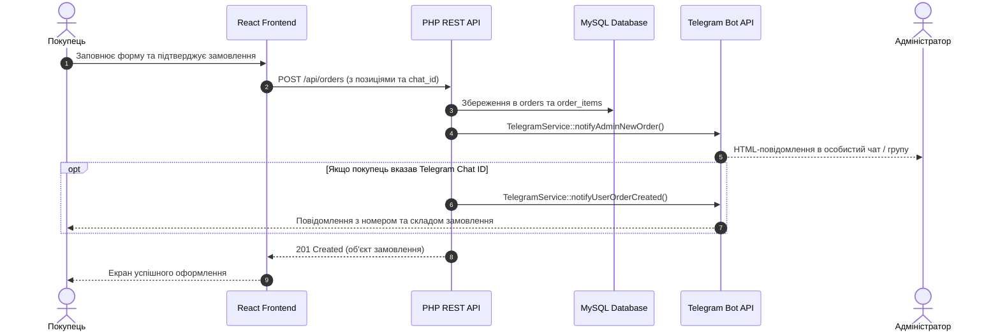

# Інтеграція з Telegram Bot API

Цей документ описує архітектуру, налаштування та сценарії роботи модуля сповіщень через **Telegram Bot API** у вебзастосунку «Dice & Deck».

---

## 1. Загальний огляд

Модуль Telegram-сповіщень реалізовано у серверному класі `backend/src/Services/TelegramService.php`. Він забезпечує:
1. **Миттєве інформування адміністраторів** про появу нового замовлення з повним складом товарів, контактними даними покупця, обраним методом оплати та адресою доставки.
2. **Інформування клієнта** про реєстрацію замовлення та подальшу зміну його статусу (якщо покупець вказав свій Telegram Chat ID).
3. **Гнучке керування** прямо з веб-панелі адміністратора (`/admin/telegram`) без необхідності вручну редагувати конфігураційні файли.
4. **Вбудоване тестування** зв'язку в один клік перед запуском у production.

---

## 2. Архітектура та потік подій



---

## 3. Налаштування Telegram-бота

### Крок 1. Створення бота у Telegram
1. Відкрийте Telegram і знайдіть офіційного бота [@BotFather](https://t.me/BotFather).
2. Надішліть команду `/newbot`.
3. Введіть назву бота (наприклад, `Dice & Deck Shop`).
4. Введіть системний юзернейм (має закінчуватися на `bot`, наприклад, `DiceDeckShopBot`).
5. Скопіюйте отриманий **HTTP API Token** (вигляду `7182930412:AAH9fkl...`).

### Крок 2. Отримання Chat ID адміністратора
- Щоб отримувати сповіщення у свій приватний чат:
  1. Знайдіть бота [@userinfobot](https://t.me/userinfobot) або надішліть йому будь-яке повідомлення.
  2. Скопіюйте свій числовий `Id` (наприклад, `481920394`).
  3. **Важливо:** обов'язково відкрийте свого щойно створеного бота і натисніть кнопку **«Start»** (`/start`), інакше Telegram заборонить боту надсилати повідомлення першим.
- Щоб отримувати сповіщення у групу/канал співробітників:
  1. Додайте створеного бота до групи з правами адміністратора.
  2. Отримайте негативний ID групи (наприклад, `-100192837465`).

### Крок 3. Збереження налаштувань в адмін-панелі сайту
1. Увійдіть на сайті під обліковим записом адміністратора.
2. Перейдіть до розділу **Адмін-панель → Налаштування Telegram** (`/admin/telegram`).
3. Заповніть поля:
   - **Токен бота (Bot Token):** вставте токен від `@BotFather`;
   - **ID чату адміністратора (Admin Chat ID):** вставте свій числовий ID;
   - **Юзернейм бота:** вкажіть назву без символу `@`;
   - **Увімкнути сповіщення:** позначте галочку.
4. Натисніть **«Зберегти налаштування»**.
5. Натисніть кнопку **«Надіслати тестове повідомлення»** — бот має миттєво надіслати вітальне повідомлення у ваш Telegram.

---

## 4. Формати повідомлень

Повідомлення надсилаються за протоколом HTTPS за допомогою cURL у форматі **HTML** (`parse_mode: 'HTML'`). Спеціальні символи користувацького введення екрануються через `htmlspecialchars` для запобігання XSS та помилок парсингу Telegram.

### 4.1. Шаблон сповіщення адміністратора про нове замовлення
```html
🔥 <b>НОВЕ ЗАМОВЛЕННЯ #ord-6725a3bc9</b>

👤 <b>Покупець:</b> Максим Ковальчук
📞 <b>Телефон:</b> +380671234567
📱 <b>Telegram клієнта (Chat ID):</b> <code>481920394</code>
🚚 <b>Доставка:</b> Нова Пошта, м. Київ, Відділення №42
💳 <b>Оплата:</b> При отриманні (накладений платіж)

💬 <b>Коментар:</b> <i>«Будь ласка, запакуйте надійно»</i>

🛒 <b>Товари:</b>
• <b>Catan: Колонізатори</b> × 1 — 1 450.00 ₴
• <b>Dixit (Діксіт)</b> × 2 — 900.00 ₴

💰 <b>РАЗОМ ДО СПЛАТИ:</b> <b>2 350.00 ₴</b>

👉 <i>Переглянути в адмінці: /admin/orders</i>
```

### 4.2. Шаблон сповіщення покупця про створене замовлення
```html
🎉 <b>Дякуємо за ваше замовлення в Dice & Deck!</b>

Ваше замовлення <code>#ord-6725a3bc9</code> успішно прийнято.

🛒 <b>Склад замовлення:</b>
• Catan: Колонізатори × 1 = 1 450.00 ₴
• Dixit (Діксіт) × 2 = 900.00 ₴

💰 <b>Сума:</b> 2 350.00 ₴
🚚 <b>Доставка:</b> м. Київ, Відділення №42

Наш менеджер зв'яжеться з вами для уточнення деталей або відправки.
```

### 4.3. Шаблон сповіщення про зміну статусу
Коли адміністратор змінює статус у панелі замовлень (`/admin/orders`), клієнт одержує оновлення:
- ⏳ `В обробці` — *«Ваше замовлення передано на комплектацію на складі»*;
- ✅ `Виконано` — *«Ваше замовлення відправлено! Номер ТТН передано службі доставки»*;
- ❌ `Скасовано` — *«Замовлення скасовано за запитом клієнта або через відсутність товару»*.

---

## 5. Обробка помилок та відмовостійкість

1. **Неблокуюче виконання:** Якщо виникає збій зв'язку з серверами Telegram або вказано невірний токен, замовлення клієнта **все одно успішно реєструється в базі даних**. Помилка Telegram не перериває транзакцію замовлення.
2. **Логування помилок:** Будь-які проблеми cURL (`CURLOPT_TIMEOUT = 6`, помилки SSL) або відповіді Telegram API з кодом відмінним від 200 логуються в системний лог PHP (`error_log`).
3. **Маскування токена:** При читанні налаштувань через API повертається маскований рядок (наприклад, `718293••••••••••••aB91cD`), що захищає секретний токен від витоку в публічний трафік.

